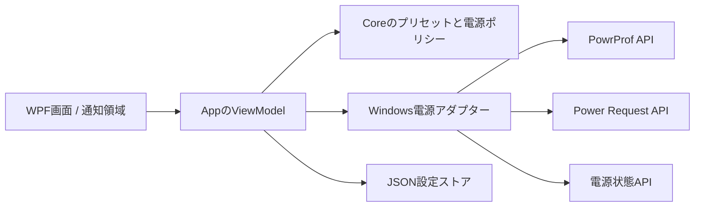
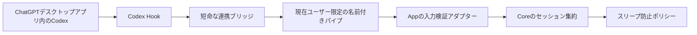

# DisplayLight 設計

## 文書の位置づけ

この文書は、2026年7月15日版の企画仕様書をDisplayLightの実装可能な境界へ整理した設計基準です。
確定していない事項は`docs/OPEN_QUESTIONS.md`へ分離しています。
未決事項が確定した場合は、この文書とArchitecture Decision Record（ADR）を同じ変更で更新します。

## 製品の責務

DisplayLightは、次の三種類の電源操作を一つの通知領域アプリから扱います。

- **アイドル時の電源設定**：利用者の明示操作により、現在のWindows電源プランにあるディスプレイ消灯時間とシステムスリープ時間を、AC時またはバッテリー時ごとに変更します。
- **スリープ防止要求**：利用者が手動で有効にする一時的な要求で、Windows電源プラン自体は変更しません。
- **手動ディスプレイ消灯**：利用者が3秒のカウントダウンを完了した場合だけ、現在のディスプレイ消灯時間を短時間変更し、Windowsの自動画面オフを一回発生させます。

この三種類は、変更の持続期間と復旧方法が異なるため、同じ抽象化にまとめません。
ディスプレイを点灯させ続ける機能も、初期範囲には含めません。

## 対象範囲

### MVP

MVPは、企画書のPhase 1からPhase 4までです。
Codexなどの外部エージェントとは連携せず、手動でスリープ防止を開始および解除できる製品として完成させます。

- WPFアプリの起動と終了
- 通知領域からの操作
- AC時とバッテリー時のディスプレイ消灯時間、およびディスプレイ消灯からシステムスリープまでの追加時間の表示と変更
- ディスプレイ消灯の「無期限」と、システムスリープの「スリープしない」
- 単一インスタンス制御
- 手動のスリープ防止
- AC電源限定
- 3秒のキャンセル可能な手動ディスプレイ消灯
- バージョン付き設定保存
- OS操作を伴わない単体テスト

Windows版ChatGPTデスクトップアプリ内のCodexとのHook連携、複数セッション、自動スリープはAgent Preview以降の独立した実装単位とします。

### Agent Preview

最初のエージェント連携対象は、Windows版ChatGPTデスクトップアプリ内のCodex専用ビューです。
2026年7月9日よりCodex単体アプリはChatGPTデスクトップアプリへ統合されているため、旧Codex単体アプリを別製品として扱いません。
Codex CLI、IDE拡張、クラウドタスクは初期対象に含めず、必要になった場合は連携元ごとのアダプターとして追加します。

Agent Previewでは、Codexの作業中だけスリープ防止要求を保持し、入力待ち、ターン停止、欠落イベントを安全側へ正規化できることを先に検証します。
スレッド全体の完了判定と自動スリープは、ChatGPTデスクトップアプリでHookのライフサイクルを実機観測した後に有効化します。

### 通知領域フライアウト

主画面は、通知アイコンの近くへ表示する幅360から392 DIPの固定幅フライアウトとします。
標準タイトルバー、リサイズ、タスクバー表示を持たせず、通知アイコンの再クリック、外側クリック、Escapeで閉じます。
外側クリックでは、クリック先のウィンドウがアクティブになった後も閉じる面を最前面に保ち、約170ミリ秒のモーション完了後に非表示にします。
クリック先が一瞬だけ手前へ描画されることを避けるため、最前面状態はフライアウトの表示開始から非表示完了まで保持し、非表示後に解除します。
通知アイコンとフライアウトは、下と上のタスクバーでは水平中心、左右のタスクバーでは垂直中心を原則として揃えます。
中央揃えで画面外へ出る場合は、作業領域から12 DIP相当の余白を残す位置へ補正します。

表示時はトップレベルウィンドウを最終位置へ固定し、フライアウト面をタスクバー側へ隠した位置から約250ミリ秒のcubic ease-outで移動します。
終了時は約170ミリ秒のcubic ease-inで同じ面をタスクバー側へ戻し、完了後にウィンドウを非表示にします。
背景、外周、影、内容を含む`FlyoutSurface`を一つのVisualとして移動し、トップレベルウィンドウの位置はフレームごとに変更しません。
Visualの変換はWPFの描画フレームへ同期し、最終位置へ到達した後に内容だけを約200ミリ秒でフェードインします。
Desktop Acrylicは固定されたウィンドウ全体へ描かれるため、Visualの移動中だけ無効化し、完成位置へ背景だけが残る状態を防ぎます。
展開、折りたたみ、エラー表示によって必要な高さが変わる場合は、通知アイコン側の辺を基準に位置とサイズを約180ミリ秒で同時に補間します。
サイズ変更中は内容をウィンドウ境界でクリップし、完了するまで内部操作を受け付けません。
サイズ変更中の一時的なオーバーフローを含め、フライアウトの縦スクロールバーは常に表示しません。
展開後と折りたたみ後の目標高は外側ウィンドウの現在高ではなく、内容を高さ無制限で再計測した`DesiredSize`と境界線から算出します。
最終サイズのレイアウトとマウス位置を再評価してから操作を再開し、表示位置とボタンの判定領域を一致させます。
伸縮が保留中の再計測や非表示操作で中断された場合も、操作停止状態は必ず解除します。
HWNDの拡張領域へDWM Backdropが先に露出しないよう、サイズ変更中だけHwndSourceのクリア色を外周面と同じ不透明色へ切り替えます。
最終サイズのWPF面が描画された次のフレームでクリア色を透明へ戻し、通常時のDesktop Acrylicを維持します。
参照する時間は録画フレームレートの影響を受けるため目安とし、完全非表示から始まることと速度曲線を優先します。
`SystemParameters.ClientAreaAnimation`が無効な場合は即時に開閉します。
開く途中の再クリックは閉じる操作へ切り替えます。
非アクティブ化による閉じ処理が始まった後に同じ通知アイコンの選択イベントが届く場合があるため、閉じる途中の選択イベントは再表示として扱いません。

外観と情報の強弱は[zwnj/BatteryMonitor](https://github.com/zwnj/BatteryMonitor)を参照します。
一枚の半透明サーフェス、小さい製品名、一つの主状態、境界線を抑えた内側カードを採り入れます。
一方、WPF `Popup`、ホバー表示、ピン留め、ドラッグ移動、手動テーマ切替は採用せず、フォーカス可能な小型WPF `Window`を維持します。

実行ファイルと通知領域のアイコンは、深いシアン`#0E7490`のディスプレイへ白い目を配置した形とします。
通知領域では色だけに依存せず、通常は片目を閉じ、スリープ防止中は両目を開き、AC電源接続待ちは両目を閉じ、エラー時は両目を×にして状態を区別します。

スリープ防止を最初の主要操作として表示し、AC電源限定を従属設定として配置します。
AC時とバッテリー時のアイドル設定は一つのセクションへまとめ、起動時は縦幅を抑えるため両方を閉じて表示します。
AC時とバッテリー時の見出しはそれぞれ独立して展開と折りたたみができ、両方を閉じた状態も許可します。

各電源側のカードには「画面をオフ」と「PCをスリープ」をこの順で配置します。
「画面をオフ」は最後の操作からディスプレイを消灯するまでの時間を選びます。
「PCをスリープ」は「画面をオフ」で選んだ時間からシステムスリープまでに追加する時間を選び、合計のアイドル時間を併記します。
通常のアイドル状態ではディスプレイが先に消灯し、その後にシステムがスリープする関係を保ちます。

両方のプリセットは、一回のクリックで選べる六つのセグメントとして一行ずつ表示し、Automationでは名前付きの選択肢として公開します。
利用者が選択した組を選択中にWindowsへ書き込まず、現在値と異なる場合だけカードごとに一つの「適用」を表示します。
「適用」の表示切替では操作領域をあらかじめ確保し、フライアウトの高さを変えません。
未適用の変更がある場合は、現在値を輪郭リング、変更後の選択をアクセント色のつまみで示し、色だけに頼らず両者を区別します。
各行の六つのプリセットは等幅に置き、時間へ比例する連続値とは扱いません。

ディスプレイ消灯時間は`1分`、`5分`、`10分`、`30分`、`60分`、`無期限`とします。
システムスリープまでの追加時間は`同時`、`5分後`、`15分後`、`30分後`、`60分後`、`スリープしない`とします。
例えば「画面をオフ」が`10分`で「PCをスリープ」が`15分後`の場合は、「PCスリープ：合計25分後」と表示します。
「画面をオフ」が`無期限`の場合は、「PCをスリープ」も`スリープしない`に固定します。
この固定中は追加時間の選択行を無効にしますが、最後に選択した追加時間は利用者設定へ保持します。
「画面をオフ」を有限の時間へ戻した場合は、保持していた追加時間を復元します。

「今すぐ画面をオフ」は消灯時間カードの下へ補助操作として配置します。
押すと同じボタン内で`3秒後にオフ`、`2秒後にオフ`、`1秒後にオフ`と表示し、再押下、Escape、外側クリック、フライアウトを閉じる操作でキャンセルします。
ゼロへ到達した場合は、フライアウトを閉じるモーションの完了後にWindowsの自動画面オフを一度だけ発生させます。

色は意味別の動的リソースへ集約し、Windowsのライトテーマ、ダークテーマ、高コントラストへ追従します。
Windows 11の背景効果を外観候補として検証し、利用できない場合と高コントラストでは単色サーフェスとDWM角丸で操作性を維持します。
最外周の角丸とWPF前景サーフェスをWindows 11のフライアウト標準である8 DIPへ揃えます。
DWMの非クライアント枠は無効化し、開閉時にVisualと一緒に移動するWPF前景サーフェスだけで外周線を描きます。

### 対象外

- エージェント自体の起動、停止、権限承認
- ユーザーが電源ボタン、蓋、スタートメニューから行う明示的なスリープの阻止
- モニター単位の制御
- クラウド同期、アカウント、テレメトリー
- プロンプト、回答、ソースコード、ファイル内容の収集
- Windows以外への移植

## 安全性の不変条件

次の条件は、UIや連携方式を変更しても維持します。

1. 既定状態では自動スリープを実行しません。
2. システムスリープを防止している間も、ディスプレイ消灯は許可します。
3. 電源要求の所有者はアプリプロセスとし、プロセス終了後に要求が残らない方式を選びます。
4. エラー、利用者の解除、アプリ終了では、スリープ防止要求を解放してWindowsの通常管理へ戻します。
5. 自動スリープは、明示的な有効化、カウントダウン、利用者が到達可能なキャンセル手段の三条件が揃う場合だけ実行します。
6. 自動テストは、実際の電源設定変更、スリープ、休止、シャットダウンを呼び出しません。
7. 外部イベント一件だけを根拠に、複数セッション全体の完了を確定しません。
8. 外部入力が不正または古い場合は、スリープ防止を無期限に保持しません。
9. 手動ディスプレイ消灯は、3秒のカウントダウンと利用者が到達可能なキャンセル手段を省略しません。
10. DisplayLightから電源設定を適用する場合は、システムスリープ時間をディスプレイ消灯時間より短くしません。
11. 手動ディスプレイ消灯のために一時変更した設定は、完了、失敗、アプリ終了時に復元します。変更中に別の値が書き込まれた場合は、その値を上書きしません。

独自の低バッテリー下限は設けません。
バッテリー消費を抑えたい利用者は、AC電源限定を選択できます。

## システム構成



Coreは判断を行い、AppはWindowsとの入出力を行います。
Win32 APIから受け取った値をCoreへ直接流さず、App側のアダプターでエラーを検証してからViewModelへ返します。
Agent Previewで連携を追加する場合は、外部入力を検証するアダプターを同じ境界へ追加します。

## ソリューション境界

### DisplayLight.Core

`DisplayLight.Core`は`net10.0`を対象とし、Windows固有APIへ依存しません。
次の責務を持たせます。

- ディスプレイ消灯時間のプリセットと秒数の対応
- ディスプレイ消灯時間と追加時間からシステムスリープ時間を求める変換
- Windowsの現在値が相対指定として表現できるかの判定
- 手動スリープ防止を要求または解放するポリシー
- AC限定の判定
- 設定値と入力値の検証
- OS操作を表すポート（インターフェース）

セッション状態、複数セッションの集約、完了後アクション、カウントダウンはAgent Previewで追加します。

フォルダーは機能が生まれた時点で`Agents`、`Power`、`Settings`などの機能単位に分けます。
空のレイヤーフォルダーを先に作りません。

### DisplayLight.App

`DisplayLight.App`は`net10.0-windows`と`win-x64`を対象とします。
次の責務を持たせます。

- WPFのViewとViewModel
- 通知領域アイコン、メニュー、通知
- アプリケーションのライフサイクルと依存関係の組み立て
- 単一インスタンス制御
- PowrProf API、Power Request API、電源状態、ファイル保存の各アダプター

Windows固有コードが増えて独立したテスト境界が必要になった場合だけ、`DisplayLight.Infrastructure.Windows`への分離を検討します。
初期段階でプロジェクトを増やすと、依存関係の管理量だけが先に増えるためです。

### DisplayLight.Core.Tests

`DisplayLight.Core.Tests`は、実機を変更せずにプリセット、設定値、電源ポリシーを検証します。
`DisplayLight.App.Tests`は、ネイティブAPIのテストダブルと一時ディレクトリを使い、WindowsアダプターとViewModelを検証します。

## 状態モデル

### MVPの手動スリープ防止

MVPでは、利用者の要求、AC限定設定、現在の電源状態を分けて保持します。
利用者の要求は、バッテリーへ切り替わって物理的な要求を解放した後も保持します。
ACへ戻った場合は、利用者が解除していなければ物理的な要求を再取得します。

| 利用者の要求 | AC限定 | 電源状態 | 物理的な要求 | 表示 |
|---|---|---|---|---|
| 無効 | 任意 | 任意 | 解放 | 無効 |
| 有効 | 無効 | 任意 | 保持 | 有効 |
| 有効 | 有効 | AC | 保持 | 有効 |
| 有効 | 有効 | バッテリー | 解放 | AC電源接続待ち |
| 有効 | 有効 | 不明 | 解放 | 電源状態不明のため解除 |

手動スリープ防止の要求状態とネイティブハンドルは永続化しません。
アプリを再起動した場合は、通常のWindows電源管理から始めます。

### Agent Previewの状態モデル

Agent Previewでは、個別セッションの`Working`、`WaitingForInput`、`Completed`、`Failed`、`Unknown`と、全体の集約状態を別に設計します。
Hookから観測した事実と製品上の状態を分け、`Stop`や`SessionEnd`など一件の外部イベントだけで全セッションの完了を確定しません。
手動要求とエージェント要求は所有者を分け、片方を解除しても別の所有者が有効なら物理的な要求を保持します。
詳細な完了規則とカウントダウンは、実機で連携イベントを観測した後に確定します。

## 電源操作

### アイドル時の電源設定

現在の電源プランは`PowerGetActiveScheme`で取得します。
AC値とDC値は`PowerReadACValueIndex`および`PowerReadDCValueIndex`で読み取ります。
変更は`PowerWriteACValueIndex`または`PowerWriteDCValueIndex`で行い、`PowerSetActiveScheme`で反映します。
対象はディスプレイ設定サブグループの`VIDEOIDLE`と、スリープ設定サブグループの[`STANDBYIDLE`](https://learn.microsoft.com/en-us/windows-hardware/customize/power-settings/sleep-settings-sleep-idle-timeout)です。
どちらも値は秒単位であり、`0`は無期限です。

消灯時間は、`1分`、`5分`、`10分`、`30分`、`60分`、`無期限`を一行のセグメントから選びます。
システムスリープまでの追加時間は、`同時`、`5分後`、`15分後`、`30分後`、`60分後`、`スリープしない`を次の行のセグメントから選びます。
MVPでは任意の数値を入力するカスタム欄を設けません。
AC時とバッテリー時は対象を切り替えて、それぞれの組を設定します。

ディスプレイ消灯時間を`D`、追加時間を`A`とした場合、Windowsへ書き込むシステムスリープ時間`S`を次のように求めます。

- `D`が`無期限`の場合は、`S`も`無期限`とします。
- `A`が`スリープしない`の場合は、`S`を`無期限`とします。
- それ以外の場合は、`S = D + A`とします。

「同時」の追加時間は`0`秒です。
この相対指定はUIとCoreのモデルであり、Windowsには最後の操作からの絶対秒数として`VIDEOIDLE`と`STANDBYIDLE`を別々に保存します。
したがって、「今すぐ画面をオフ」ボタンによる一回限りの手動消灯は、追加時間の計測開始条件にはなりません。

適用前に対象電源側の両方の現在値を保持し、ディスプレイ消灯時間とシステムスリープ時間を一組として書き込みます。
書き込み、電源プランの反映、または読戻しのいずれかに失敗した場合は、変更前の組への復旧を試みます。
復旧の成否にかかわらず両方の実値を再取得し、要求した組と一致した場合だけ成功と表示します。

`powercfg`の出力は利用せず、表示言語に依存する文字列を解析しません。
Windows側にプリセット外の値がある場合は、その実値と追加時間を表示し、選択を近い値へ黙って移動しません。
システムスリープ時間がディスプレイ消灯時間より短い場合、またはディスプレイ消灯が無期限でシステムスリープだけが有限の場合は、「Windowsで個別に設定」と表示します。
この状態も自動修正せず、利用者がDisplayLightのプリセットを選択して「適用」した場合だけ、相対指定の組へ変更します。
保存されている二つのプリセット選択は「前回選択」として示し、利用者が選択を変えるまでは未適用変更として扱いません。

利用者が明示的に変更したディスプレイ消灯時間とシステムスリープ時間は、現在の電源プランに対する通常の設定変更です。
アプリ終了時に自動復元する一時変更とは扱いません。
変更前の値へ戻す専用操作も設けず、利用者はプリセット行から別の値へ切り替えます。

### スリープ防止要求

スリープ防止には`PowerCreateRequest`、`PowerSetRequest`、`PowerClearRequest`を使用します。
理由文字列を持つプロセス所有の要求を作成し、利用者が必要とする期間だけ保持します。

要求種別は`SystemRequired`だけとし、`DisplayRequired`、`AwayModeRequired`、`ExecutionRequired`は使用しません。
これによりアイドルによるシステムスリープを抑止しながら、設定時間後のディスプレイ消灯を許可します。
スリープ防止中もアイドル時の電源設定は変更できます。
Power Request APIによる要求が有効な間は、設定したシステムスリープ時間が経過してもスリープを抑止します。
UIには「スリープ防止中も画面は設定時間後に消えます」と表示します。

利用者が明示したスリープ、システムポリシー、Modern StandbyのDC時制約はOS側が優先されます。
Modern Standbyのバッテリー動作では、システムスリープタイムアウト後に要求の効力が制限されるため、常時維持を保証しません。
復帰通知を受けた場合は、要求が有効だったときだけハンドルを作り直します。

### 手動ディスプレイ消灯

手動ディスプレイ消灯には、Windowsの`VIDEOIDLE`による自動画面オフを使用します。
フライアウトを閉じた後、現在の電源プランと電源側にある`VIDEOIDLE`を読み取り、その値を1秒へ変更します。
5秒後に変更前の値へ戻し、元の電源プランが引き続き有効な場合だけ再反映します。
`STANDBYIDLE`、反対側の電源設定、DisplayLightの保存設定は変更しません。

復元前に`VIDEOIDLE`を読み直し、1秒以外へ変わっていた場合は、利用者または別アプリによる新しい変更として維持します。
例外時とアプリ終了時にも復元を試みます。
一時変更前に電源プラン、対象電源側、元の秒数をローカルの復旧情報へ保存し、プロセスが強制終了した場合は次回起動時に同じ条件で復元します。
復旧情報には電源設定の復元に必要なメタデータだけを保存します。

`SC_MONITORPOWER`は使用しません。
Modern Standby対応機での実機検証では、バッテリー駆動中に`SC_MONITORPOWER`で消灯すると通常のデスクトップ処理が停止し、Windowsの自動画面オフでは処理が継続したためです。
この操作はスリープ防止要求を変更しません。
マウスやキーボードなど、Windowsが認識する入力による再点灯を妨げません。
カウントダウン状態はプロセス内だけに保持し、フライアウトを閉じた場合やアプリ終了時に破棄します。
自動テストではネイティブ呼び出しをテストダブルへ置き換え、実際のディスプレイは消灯しません。

### 自動スリープ

自動スリープは後続機能です。
`SetSuspendState(false, false, false)`相当の呼び出しは、Coreがカウントダウン完了を確定した後、Appの専用アダプターから一度だけ行います。

実行直前に新しい`Working`セッション、電源条件、キャンセル状態を再評価します。
API失敗時は再試行ループに入らず、失敗を通知して通常の電源管理へ戻します。

## エージェント連携

この章はAgent Previewの検討事項であり、MVPにはIPC、Hook、セッション集約を実装しません。
対象はWindows版ChatGPTデスクトップアプリ内のCodexです。
公式の[ChatGPTデスクトップアプリ](https://learn.chatgpt.com/docs/app)および[Codex Hooks](https://learn.chatgpt.com/docs/hooks)の2026年7月28日時点の仕様を基準とします。

### 推奨データフロー



HookはCodexが公式に提供するライフサイクル境界です。
連携ブリッジはHookから標準入力で一件のJSONを受け取り、必要なメタデータだけを内部イベントへ正規化して、名前付きパイプへ短時間で送信します。
WPFプロセス、Core、Windows電源APIをHookプロセス内へ読み込まず、連携失敗がCodexのターンを妨げない境界を保ちます。

会話履歴ファイルの監視、ChatGPTデスクトップアプリのUI Automation、ウィンドウタイトルの解析、プロセスの存在だけによる状態判定は採用しません。
これらは公開された安定インターフェースではなく、プロンプトや回答を誤って取り込む危険もあるためです。

### イベント境界

連携コマンドは、標準入力で受け取ったHookイベントを、バージョン付きの内部イベントへ変換します。
最低限の内部フィールドは次のとおりです。

```text
schemaVersion
source
sessionId
turnId（ターン単位のイベントだけ）
eventType
occurredAtUtc
workspaceId（任意、既定では非永続）
```

IPC受信側は、スキーマ版、文字数、時刻のずれ、イベント種別を検証します。
セッション識別子は連携元の値をそのままログへ出さず、必要な場合はプロセス内で短縮またはハッシュ化します。
Hook payloadに含まれる`prompt`、`last_assistant_message`、`transcript_path`は内部イベントへ転送せず、読み取りも保存もしません。

### Codex Hookの意味

Codexの設定レイヤーはChatGPTデスクトップアプリ、CLI、IDE拡張で共有されます。
公開されているHookの共通入力は`session_id`、`transcript_path`、`cwd`、`hook_event_name`、`model`を持ちますが、起動元サーフェスを直接示すフィールドは文書化されていません。
ChatGPTデスクトップアプリだけを確実に識別する方法は、Q18と実機観測で決定します。

初期の連携ブリッジは次の事実だけを内部イベントへ変換します。

| Hook | 観測できる事実 | 初期の扱い |
|---|---|---|
| `SessionStart` | セッションの開始、再開、クリア、またはコンパクション | セッションを認識するが、単独では`Working`にしない |
| `UserPromptSubmit` | 利用者のプロンプトによるターン開始 | `Working`候補とし、leaseを開始または更新する |
| `PermissionRequest` | Codexが利用者へ権限確認を求める直前 | `WaitingForInput`候補とし、承認または拒否には介入しない |
| `Stop` | Codexの一つのターンが停止した | ターン停止として扱い、`Completed`にはしない |
| `SessionEnd` | セッションが終了条件へ達した | 非アクティブ化の補助事実とし、即時の作業完了にはしない |

`SessionEnd`は、開いている会話のアーカイブまたは削除、Codexの正常終了、あるいは接続クライアントで開かれていない状態が30分続いた場合に発火します。
そのため、利用者が作業を終えた瞬間の通知としては遅すぎる場合があり、`Completed`や自動スリープの直接条件には使いません。

`PermissionRequest` Hookは権限判断を変更できますが、DisplayLightは判断を返さず、通常のCodex承認画面を維持します。
製品上の`Completed`を何から確定するかは、ChatGPTデスクトップアプリでHook payloadと画面上のライフサイクルを記録した後に決めます。

### IPC

WPFアプリは、現在のWindowsユーザーだけが接続できる名前付きパイプを待ち受けます。
メッセージは長さ上限を持つ一件一JSON形式とし、プロトコル版が一致しない入力を拒否します。

アプリが起動していない場合の扱いは未決です。
連携コマンドがアプリを起動する方式と、イベントを破棄して終了する方式のどちらにするかをQ8で決定します。

### 欠落イベント

Hookプロセスの異常終了やアプリ再起動では、終了イベントが欠落します。
そのため、セッションには最終観測時刻と有効期限を持たせ、永続化したセッション状態を無条件に復元しません。

`UserPromptSubmit`だけでは長いターンの生存を確認できないため、必要なら`PreToolUse`または`PostToolUse`を内容を保存しないheartbeatとして追加します。
有効期限の長さとheartbeatの要否は、ChatGPTデスクトップアプリの長時間タスクを観測して決めます。
単なるプロセス存在確認は`Working`の確証にせず、補助情報として扱います。

## アプリのライフサイクル

1. WPFを開始する前にVelopackの更新ライフサイクルを処理します。
2. インストールまたは更新の完了時は、現在ユーザーのスタートアップ登録を不足時だけ作成します。
3. 単一インスタンス用の所有権を取得します。
4. OSアダプター、設定ストア、更新サービス、ViewModelを生成します。
5. 非表示のWPFフライアウトからウィンドウハンドルを作成します。
6. 通知領域アイコンを追加します。
7. 通常起動では通知アイコンの近くへフライアウトを表示し、スタートアップ起動では非表示を維持します。
8. 設定と現在のWindows電源状態を読み込みます。
9. 起動から20秒後に、インストール版だけ安定版の更新を確認します。
10. 終了要求では電源要求を解放し、通知領域アイコンを削除します。
11. 終了処理の一部が失敗しても、残りの解放処理を継続します。

二重起動したプロセスは、既存プロセスへ表示要求を送り、自身は電源状態を変更せず終了します。
ただし、スタートアップによる二重起動は既存フライアウトを表示しません。
フライアウトを閉じる操作は表示だけを終了し、補助メニューまたは通知領域の「終了」だけがプロセスを終了します。

## 設定保存

設定は`%LOCALAPPDATA%\DisplayLight\settings.json`へ保存します。
ローミング同期を意図しない端末固有の電源設定であるため、`ApplicationData`のRoaming配下は使用しません。

設定には`schemaVersion`を含めます。
保存時は同じディレクトリへ一時ファイルを書き、フラッシュ後に置き換えて、途中終了による破損を抑えます。

永続化するのは利用者設定だけです。
MVPでは、選択したACとDCのディスプレイ消灯プリセット、システムスリープ追加時間のプリセット、およびAC限定設定を保存します。
既存の設定スキーマから移行する場合はディスプレイ消灯プリセットとAC限定設定を維持し、追加時間の初期値をAC時とバッテリー時とも`15分後`とします。
移行と起動だけではWindows電源プランを変更せず、利用者が「適用」を押した場合だけ二つの値を書き込みます。
手動スリープ防止の要求状態と電源要求ハンドルはプロセス内状態とし、再起動後に復元しません。

## エラーと通知

Windowsアダプターは失敗コードを例外へ変換し、ViewModelが利用者向けの状態表示へ反映します。
UIは成功通知を表示せず、変更後の読戻しが完了した場合だけ現在値を更新します。

- OS操作失敗：実行しようとした操作の近くへWindowsエラーコードを表示します。
- 全体操作失敗：再読み込みなど対象を一つに限定できないエラーだけをヘッダー付近へ表示します。
- 電源状態取得失敗：AC限定時は要求を解放し、通常のWindows電源管理へ戻します。
- 電源要求失敗：利用者の要求状態を解除し、ネイティブハンドルを閉じます。
- 設定破損：元ファイルを`settings.corrupt.<UTC時刻>.json`として残し、安全な既定値で起動します。

## プライバシーとセキュリティ

インストール版は、起動後と利用者の明示操作時にGitHub Releasesへ更新を問い合わせます。
更新通信で送るのはGitHub Releasesの取得に必要な通常のHTTP情報だけであり、設定、電源状態、作業ディレクトリ、ログを送信しません。
公開リポジトリへの問い合わせは認証トークンを使用しません。

Agent Previewで名前付きパイプを採用する場合は現在ユーザーへ限定し、受信サイズ、JSONの深さ、文字列長を制限します。
作業ディレクトリを扱う場合はUI表示に必要な間だけプロセス内で保持し、設定と通常ログへ保存しません。
Codex Hookの`prompt`、`last_assistant_message`、`transcript_path`は連携ブリッジで破棄し、名前付きパイプ、設定、ログへ送信しません。

ログの既定レベル、保存期間、利用者による消去方法はQ16で決定します。

## 検証戦略

検証は、純粋ロジック、Windowsアダプター、実機挙動の三段階に分けます。

- Core単体テスト：プリセット変換、相対時間と絶対時間の変換、個別設定の判定、設定の正規化、手動要求とAC限定の優先順位。
- アダプターテスト：二つの電源設定に対するPowrProf APIの呼び出し順序、読戻し、復旧、エラー変換、設定の原子的保存。
- 実機テスト：通知領域、ACとバッテリー、ディスプレイ消灯後のシステムスリープ、スリープ防止中の消灯、Modern Standby、スリープと復帰。

実機テストの手順と記録項目は`docs/TESTING.md`に定義します。
CIはWindows上でformat、Release build、unit testを実行し、実電源操作は行いません。

## 配布

初期ターゲットはx64のWindows 11です。
配布物はVelopackで生成する自己完結型のSetupとPortable ZIPです。
Setupで導入したインストール版だけが、GitHub Releasesの安定版を更新元としてアプリ内更新を利用できます。
Portable ZIPはインストールせず試す用途とし、アプリ内更新を適用しません。

起動から20秒後の確認は更新が見つかった場合だけ画面へ通知します。
手動確認では、最新版、インストール版ではない状態、確認失敗も画面へ表示します。
ダウンロードと再起動は利用者が「更新して再起動」を押した場合だけ行います。
更新適用前に手動消灯のカウントダウンとスリープ防止要求を解除します。

インストール版は、`HKCU\Software\Microsoft\Windows\CurrentVersion\Run`へVelopackランチャーと`--startup`を登録します。
この登録はWindowsのタスクマネージャーに表示され、利用者が「スタートアップ アプリ」から有効または無効を切り替えます。
DisplayLightは既存の登録内容が正しい場合に値を書き直さず、Windowsが保持する無効状態を変更しません。
Portable版は登録せず、アンインストール時は登録値を削除します。
自動起動の判断は`docs/adr/0007-user-startup-registration.md`に記録します。

コード署名は未決です。
判断の詳細は`docs/adr/0006-velopack-updates.md`に記録します。

## 変更の記録

次の変更はADRを追加します。

- 電源要求APIの選択
- ディスプレイ設定の読み書き方式
- 通知領域ライブラリまたは直接Win32実装の選択
- IPC方式と起動方式
- 設定形式または保存場所の変更
- 配布形式と自動更新方式

小さく戻せる実装詳細はADRにせず、コードとテストで説明します。
